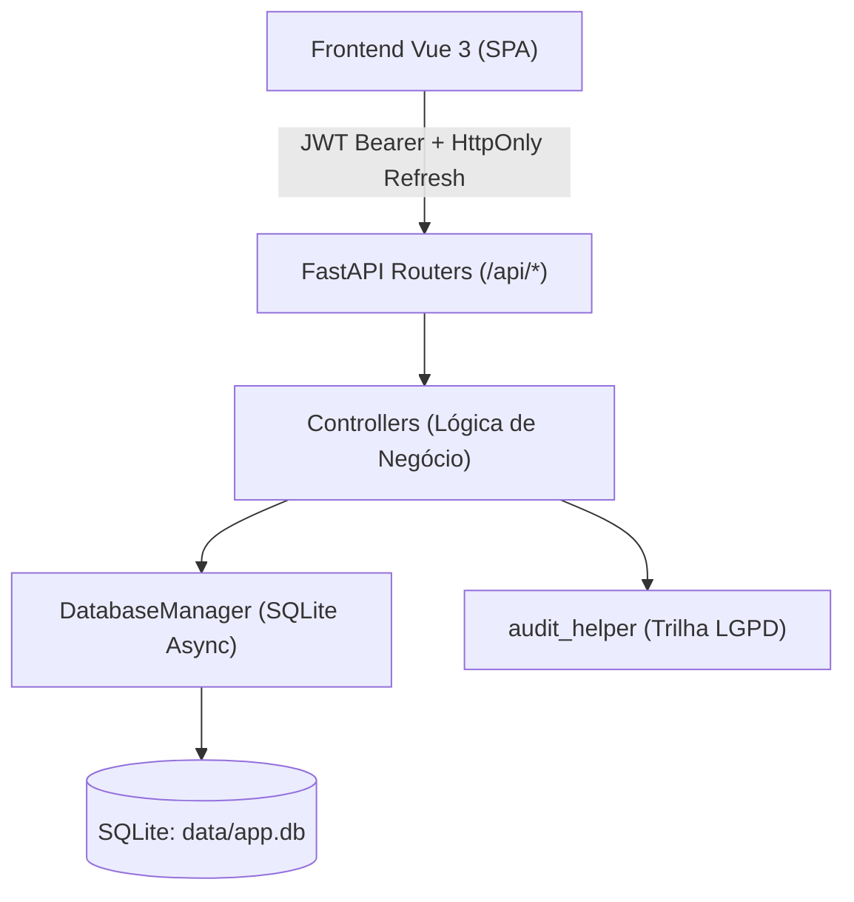

# Design: Modelo Base de Gestão de Riscos (HC-UFPE)

## 1. Visão Geral da Arquitetura

O sistema é construído sobre o monolito padrão **Framework-SETISD-HC-UFPE**:
* **Backend:** FastAPI (Python 3.12+), SQLAlchemy 2.0 assíncrono, SQLite local (`data/app.db`) e Alembic para migrações.
* **Segurança:** Autenticação híbrida AD (LDAP/Mock) + autorização local RBAC + HttpOnly Cookies + Security Headers.
* **Frontend:** Vue 3 (Composition API / TypeScript) + Vite + Tailwind CSS + Pinia.

---

## 2. Modelo de Dados Relacional (SQLite / SQLAlchemy)

### A. Tabelas Organizacionais e de Governança
1. **`unidades_organizacionais`**
   * `id`: INTEGER (PK)
   * `sigla`: VARCHAR(30)
   * `nome`: VARCHAR(200) NOT NULL
   * `tipo`: ENUM (`ORGAO_INDEPENDENTE`, `GERENCIA`, `DIVISAO`, `SETOR`, `UNIDADE`)
   * `unidade_pai_id`: INTEGER (FK nullable -> `unidades_organizacionais.id`)
   * `ativa`: BOOLEAN (Default True)

2. **`macroprocessos`**
   * `id`: INTEGER (PK)
   * `codigo`: VARCHAR(20)
   * `nome`: VARCHAR(200) NOT NULL
   * `area_guardia_unidade_id`: INTEGER (FK -> `unidades_organizacionais.id`)

3. **`processos`**
   * `id`: INTEGER (PK)
   * `macroprocesso_id`: INTEGER (FK -> `macroprocessos.id`)
   * `codigo`: VARCHAR(20)
   * `nome`: VARCHAR(200) NOT NULL
   * `is_transversal`: BOOLEAN (Default False)
   * `permite_projeto`: BOOLEAN (Default False)

4. **`pilares_estrategicos`**
   * `id`: INTEGER (PK)
   * `numero`: INTEGER
   * `nome`: VARCHAR(200) NOT NULL

---

### B. Gestão de Usuários, RBAC e Matriz de Visibilidade
5. **`usuarios`**
   * `id`: INTEGER (PK)
   * `username`: VARCHAR(100) UNIQUE NOT NULL (login AD)
   * `nome_completo`: VARCHAR(200) NOT NULL
   * `email`: VARCHAR(150) UNIQUE NOT NULL
   * `perfil`: ENUM (`ADMINISTRADOR`, `GESTOR_UNIDADE`, `CONSULTA_SETORIAL`)
   * `unidade_principal_id`: INTEGER (FK -> `unidades_organizacionais.id`)
   * `ativo`: BOOLEAN (Default True)
   * `criado_em`: DATETIME

6. **`usuario_unidades_visibilidade`** (Mecanismo "Quem vê o relatório de quem")
   * `id`: INTEGER (PK)
   * `usuario_id`: INTEGER (FK -> `usuarios.id`)
   * `unidade_id`: INTEGER (FK -> `unidades_organizacionais.id`)
   * `permite_edicao`: BOOLEAN (Default False)
   * `concedido_por_id`: INTEGER (FK -> `usuarios.id`)
   * `concedido_em`: DATETIME

---

### C. Mapeamento e Avaliação de Riscos
7. **`mapeamentos_risco`**
   * `id`: INTEGER (PK)
   * `unidade_id`: INTEGER (FK -> `unidades_organizacionais.id`)
   * `processo_id`: INTEGER (FK -> `processos.id`)
   * `possui_projeto`: BOOLEAN (Default False)
   * `nome_projeto`: VARCHAR(200) (Nullable)
   * `pilar_estrategico_id`: INTEGER (FK -> `pilares_estrategicos.id`, Nullable)
   * `entrega_processo`: TEXT NOT NULL
   * `status`: ENUM (`RASCUNHO`, `SUBMETIDO`, `EM_MONITORAMENTO`, `REVISAO_SOLICITADA`, `ENCERRADO`)
   * `criado_por_id`: INTEGER (FK -> `usuarios.id`)
   * `criado_em`: DATETIME
   * `atualizado_em`: DATETIME

8. **`eventos_risco`**
   * `id`: INTEGER (PK)
   * `mapeamento_id`: INTEGER (FK -> `mapeamentos_risco.id` ON DELETE CASCADE)
   * `descricao_evento`: TEXT NOT NULL
   * `causa`: TEXT NOT NULL
   * `consequencia`: TEXT NOT NULL
   * `categoria`: ENUM (`OPERACIONAL`, `LEGAL_CONFORMIDADE`, `FINANCEIRO_ORCAMENTARIO`, `IMAGEM_REPUTACAO`, `SEGURANCA_INFORMACAO`, `ASSISTENCIAL_PACIENTE`, `INTEGRIDADE`)

9. **`avaliacoes_risco`**
   * `id`: INTEGER (PK)
   * `evento_risco_id`: INTEGER (FK -> `eventos_risco.id` ON DELETE CASCADE)
   * `probabilidade`: INTEGER NOT NULL (1 a 5)
   * `impacto`: INTEGER NOT NULL (1 a 5)
   * `risco_inerente`: INTEGER NOT NULL ($P \times I$, 1 a 25)
   * `fator_mitigacao`: FLOAT NOT NULL (0.2 a 1.0)
   * `risco_residual`: INTEGER NOT NULL ($\text{round}(\text{Inerente} \times \text{Fator})$)
   * `classificacao`: ENUM (`BAIXO`, `MEDIO`, `ALTO`, `EXTREMO`)
   * `acima_apetite`: BOOLEAN NOT NULL (True se residual > 7.99)

10. **`controles_existentes`**
    * `id`: INTEGER (PK)
    * `avaliacao_id`: INTEGER (FK -> `avaliacoes_risco.id` ON DELETE CASCADE)
    * `descricao_controle`: TEXT NOT NULL

11. **`planos_acao_5w2h`**
    * `id`: INTEGER (PK)
    * `evento_risco_id`: INTEGER (FK -> `eventos_risco.id` ON DELETE CASCADE)
    * `tipo_resposta`: ENUM (`MITIGAR`, `EVITAR`, `COMPARTILHAR`, `ACEITAR`)
    * `o_que`: TEXT NOT NULL
    * `como`: TEXT NOT NULL
    * `quem`: VARCHAR(200) NOT NULL
    * `data_inicio`: DATE NOT NULL
    * `data_termino`: DATE NOT NULL
    * `status`: ENUM (`PLANEJADO`, `EM_ANDAMENTO`, `CONCLUIDO`, `CANCELADO`)

12. **`planos_contingencia`**
    * `id`: INTEGER (PK)
    * `evento_risco_id`: INTEGER (FK -> `eventos_risco.id` ON DELETE CASCADE)
    * `gatilho`: TEXT NOT NULL
    * `o_que`: TEXT NOT NULL
    * `como`: TEXT NOT NULL
    * `responsavel`: VARCHAR(200) NOT NULL

---

## 3. Endpoints da API REST (Default-Private Router Pattern)

Todos os roteadores declaram dependência de autenticação:
`router = APIRouter(prefix="/api/...", dependencies=[Depends(auth_handler.decode_token)])`

| Método | Rota | Descrição | Permissão |
| :--- | :--- | :--- | :--- |
| `GET` | `/api/unidades` | Lista unidades do hospital | Todos |
| `GET` | `/api/processos` | Lista macroprocessos e processos com filtros | Todos |
| `GET` | `/api/pilares-estrategicos` | Lista os pilares do Mapa Estratégico | Todos |
| `GET` | `/api/admin/usuarios` | Lista usuários e unidades vinculadas | `ADMINISTRADOR` |
| `POST` | `/api/admin/usuarios` | Cadastra/atualiza usuário e seu perfil | `ADMINISTRADOR` |
| `POST` | `/api/admin/visibilidade` | Concede/revoga visibilidade de setor para usuário | `ADMINISTRADOR` |
| `GET` | `/api/riscos` | Lista mapeamentos (filtrados por permissão setorial) | Setorial / Admin |
| `POST` | `/api/riscos` | Cria ou atualiza mapeamento (Rascunho ou Submetido) | Gestor do Setor |
| `GET` | `/api/riscos/{id}` | Detalhes completos do mapeamento de risco | Autorizado |
| `POST` | `/api/riscos/{id}/status` | Altera status (ex: aprovação pela UGERC) | UGERC / Admin |
| `GET` | `/api/riscos/painel/matriz` | Dados agregados para montagem da matriz 5x5 | Setorial / Admin |

---

## 4. Estrutura do Frontend (Vue 3 SPA)

1. **`src/views/riscos/MapeamentoWizard.vue`**: Formulário em 5 etapas respeitando o Guia da UGERC com salvamento em Rascunho.
2. **`src/views/riscos/PainelRiscos.vue`**: Lista de riscos com filtros rápidos e Matriz 5x5 interativa.
3. **`src/views/admin/GestaoUsuariosVisibilidade.vue`**: Interface para administradores cadastrarem gestores e configurarem permissões cruzadas.
4. **`src/components/riscos/MatrizRisco5x5.vue`**: Componente visual do quadrante de calor (Baixo, Médio, Alto, Extremo) com *badge* de apetite a risco.
